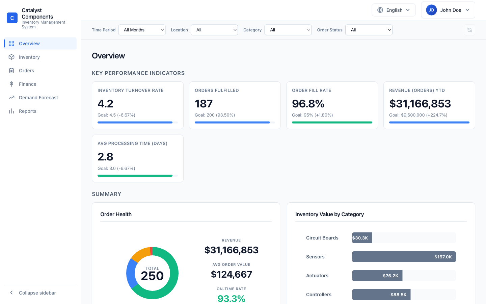

# Catalyst Components Inventory Management System: Documentation

| | |
|---|---|
| Product | Factory Inventory Management System (demo) |
| Version | 1.0.0 (server `pyproject.toml`) |
| Document date | 2026-11-05 |
| Audience | Business users, administrators, developers |
| Status | Draft for review |



## What the system does

The system gives an operations team one place to see stock, customer orders, costs and demand for a parts factory with three warehouses (San Francisco, London, Tokyo). Every page shares one filter bar, so a manager can look at the same slice of the business (for example "Tokyo, Sensors, March") across inventory, orders and finance.

The app is a demo. It has no database and no login. All data comes from JSON files that the server loads into memory at start.

## Documents

| Document | For | Contents |
|---|---|---|
| [User Guide](user-guide.md) | Business users | Layout, navigation, filters, every page, tasks, language, mobile use |
| [Technical Reference](technical-reference.md) | Developers, administrators | Architecture, setup, configuration, REST API, data model, i18n, testing, operations |
| [Known Issues and Limitations](known-issues.md) | Everyone | Gaps found while writing this documentation, with file references |

## Quick start

```bash
# Backend (port 8001)
cd server && uv run python main.py

# Frontend (port 3000)
cd client && npm install && npm run dev
```

Open http://localhost:3000.

## Screenshot index

All screenshots were taken with Playwright against the running app at 1440x900 (desktop) and 390x844 (phone), in English unless noted.

| File | Shows |
|---|---|
| `images/01-overview.png` | Overview page |
| `images/02-inventory.png` | Inventory page |
| `images/03-orders.png` | Orders page |
| `images/04-finance.png` | Finance page |
| `images/05-demand.png` | Demand Forecast page |
| `images/06-reports.png` | Reports page |
| `images/07-filters-applied.png` | Orders filtered to Tokyo + Shipped |
| `images/08-profile-menu.png` | Profile menu open |
| `images/09-tasks-modal.png` | My Tasks dialog |
| `images/10-japanese.png` | Overview in Japanese (JPY) |
| `images/11-sidebar-collapsed.png` | Sidebar collapsed to icons |
| `images/12-mobile.png` | Phone layout |
| `images/13-mobile-drawer.png` | Phone navigation drawer |
| `images/14-inventory-detail.png` | Inventory item detail dialog |
| `images/15-create-po.png` | Create purchase order dialog |
| `images/16-view-po.png` | Purchase order after reload (View PO) |
