# User Guide

[Documentation home](README.md) · [Technical Reference](technical-reference.md) · [Known Issues](known-issues.md)

## Contents

1. [Screen layout](#1-screen-layout)
2. [Filters](#2-filters)
3. [Overview](#3-overview)
4. [Inventory](#4-inventory)
5. [Orders](#5-orders)
6. [Finance](#6-finance)
7. [Demand Forecast](#7-demand-forecast)
8. [Reports](#8-reports)
9. [Profile and tasks](#9-profile-and-tasks)
10. [Language and currency](#10-language-and-currency)
11. [Sidebar and small screens](#11-sidebar-and-small-screens)
12. [Status colours](#12-status-colours)

---

## 1. Screen layout

Every page has the same frame:

| Area | Position | Contents |
|---|---|---|
| Sidebar | Left | Company name, the six pages, "Collapse sidebar" button at the bottom |
| Top bar | Top right | Language switcher, profile menu |
| Filter bar | Under the top bar | Time Period, Location, Category, Order Status, reset button |
| Content | Centre | The page you opened |

The current page is highlighted in the sidebar with a blue background and a blue bar on the left.

| Page | Address | Purpose |
|---|---|---|
| Overview | `/` | KPIs, order health, shortages, top products |
| Inventory | `/inventory` | Stock levels per SKU |
| Orders | `/orders` | Customer orders and their status |
| Finance | `/spending` | Revenue, costs, profit, transactions |
| Demand Forecast | `/demand` | Expected demand per item |
| Reports | `/reports` | Quarterly and monthly performance |

## 2. Filters

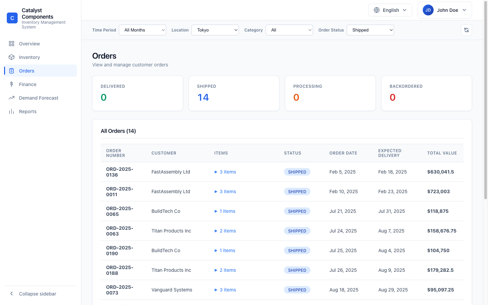

The filter bar stays at the top while you scroll. A filter applies to every page at once and stays set when you switch pages.

| Filter | Values | Pages that use it |
|---|---|---|
| Time Period | All Months, January to December 2025 | Overview, Orders, Finance |
| Location | All, San Francisco, London, Tokyo | Overview, Inventory, Orders, Demand Forecast |
| Category | All, Circuit Boards, Sensors, Actuators, Controllers, Power Supplies | Overview, Inventory, Orders, Demand Forecast |
| Order Status | All, Delivered, Shipped, Processing, Backordered | Overview, Orders |

The round-arrow button on the right resets all four filters to "All". It is greyed out while no filter is set.

Reports ignores all filters. Inventory has no time dimension, so Time Period does not change it.

**Example.** Location = Tokyo and Order Status = Shipped on the Orders page shows 14 orders, and the four status cards update to match (picture above).

## 3. Overview

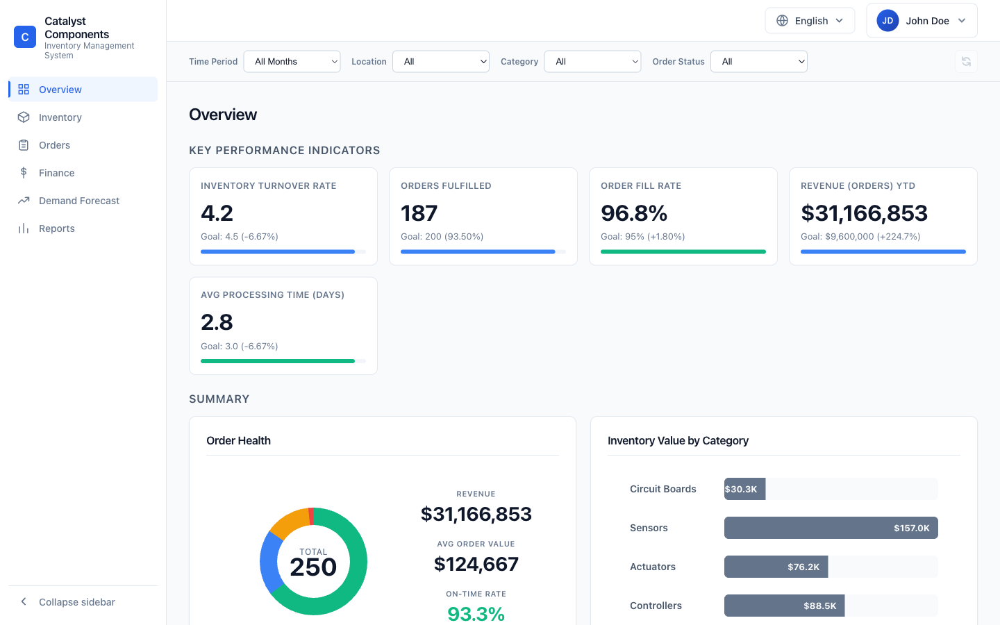

**Key Performance Indicators.** Five cards. Each shows the value, the goal, the difference to the goal and a progress bar.

| KPI | Goal | Notes |
|---|---|---|
| Inventory Turnover Rate | 4.5 | Fixed demo value |
| Orders Fulfilled | 200 | Fixed demo value |
| Order Fill Rate | 95% | Fixed demo value |
| Revenue (Orders) YTD | $9.6M for all months, $800K for one month | Calculated from the filtered orders |
| Avg Processing Time (days) | 3.0 | Fixed demo value |

**Summary.**
- *Order Health*: ring chart of orders by status (Delivered, Shipped, Processing, Backordered) with the total in the middle. Revenue, Avg Order Value, On-Time Rate and Avg Fulfillment (days) are shown next to it.
- *Inventory Value by Category*: one bar per category.

**Inventory Shortages.** Orders that cannot be filled from stock. Columns: Order ID, SKU, Item Name, Quantity Needed, Quantity Available, Shortage, Days Delayed, Priority, Actions. Click a row to see its details. Click "Create PO" to raise a purchase order for the shortage: enter supplier, quantity (pre-filled with the shortage), unit cost (pre-filled from inventory), expected delivery date and optional notes. Once a PO exists the button changes to "View PO". Only one PO per shortage is allowed.

| Create PO | View PO |
|---|---|
| 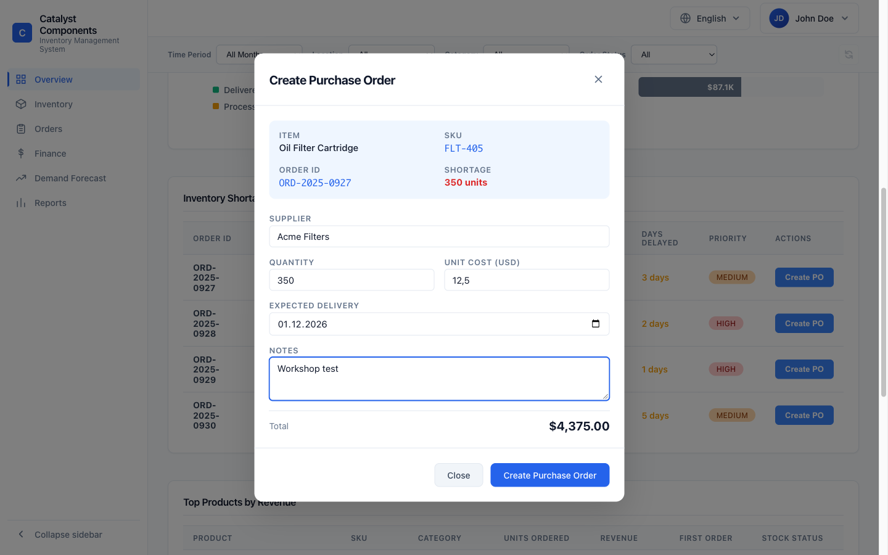 | 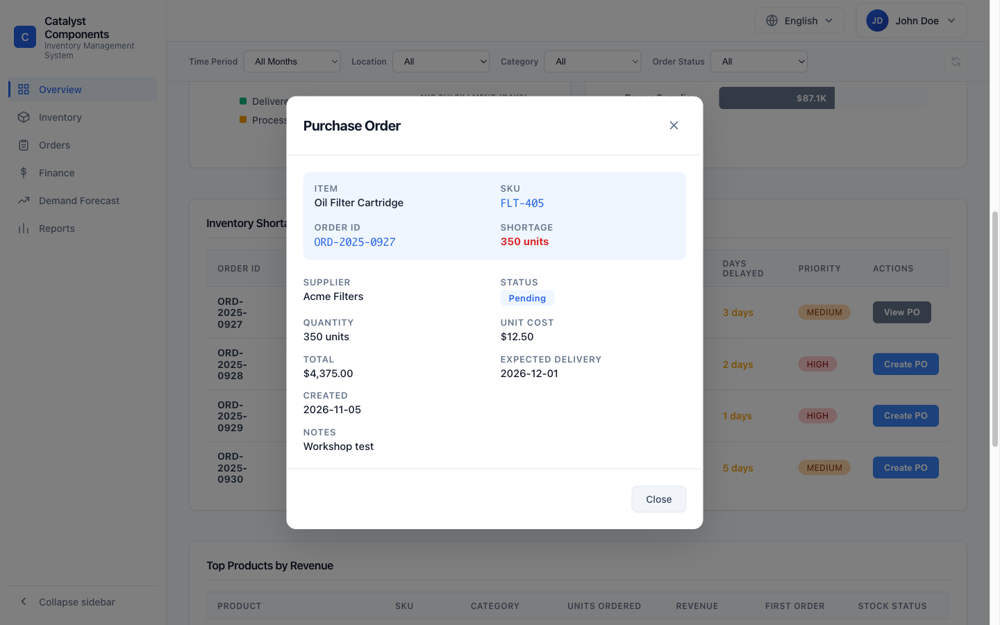 |

**Top Products by Revenue.** Twelve products with SKU, category, units ordered, revenue, first order date and stock status. Click a row for product details.

## 4. Inventory

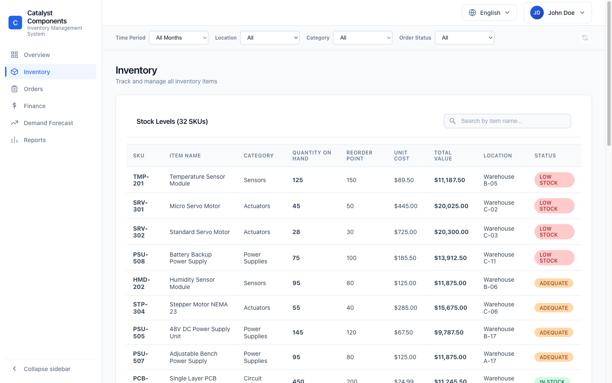

"Stock Levels" lists every SKU (32 in the demo data). Columns: SKU, Item Name, Category, Quantity on Hand, Reorder Point, Unit Cost, Total Value, Location, Status.

**Search.** Type in "Search by item name..." to narrow the list. The search matches the item name only, not the SKU.

**Status rules.**

| Status | Rule |
|---|---|
| Low Stock | Quantity on hand is at or below the reorder point |
| Adequate | Up to 1.5 x the reorder point |
| In Stock | Above 1.5 x the reorder point |

The list is always ordered Low Stock first, then Adequate, then In Stock.

**Item details.** Click a row to open the detail dialog. It shows quantity on hand, stock level as a percentage of the reorder point, category, location, reorder point, units remaining before the reorder point, unit cost, total value, warehouse and status.

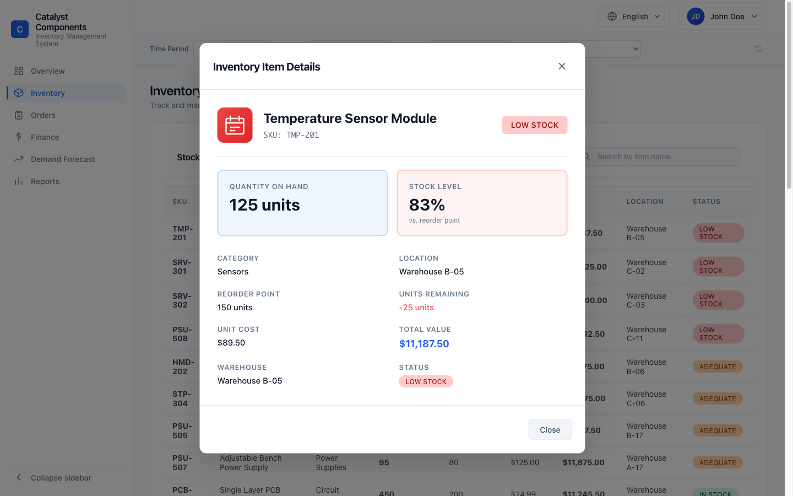

## 5. Orders

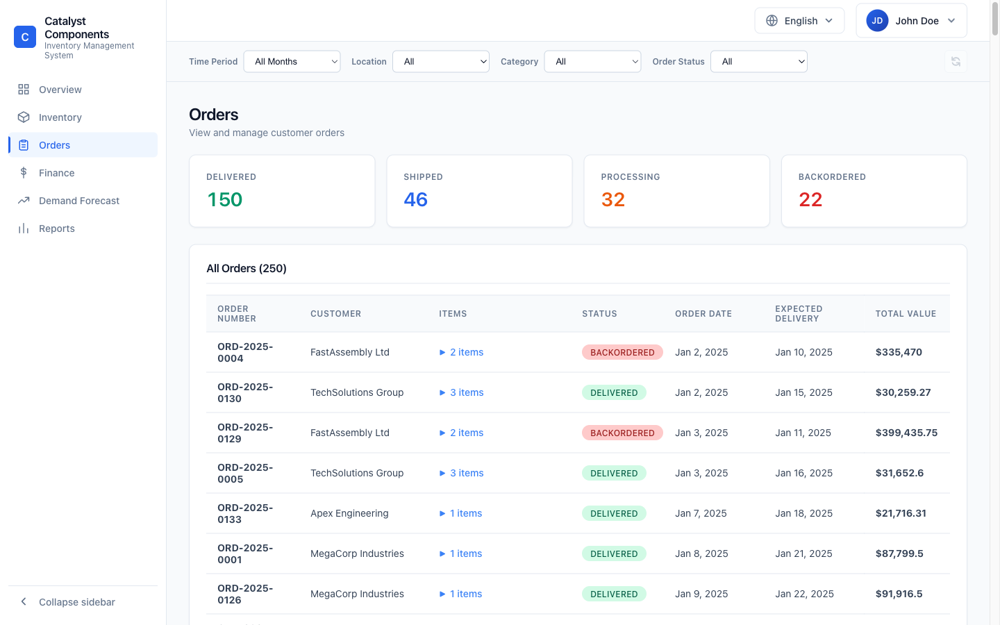

Four cards count orders by status: Delivered, Shipped, Processing, Backordered.

"All Orders" lists every order matching the filters, oldest first. Columns: Order Number, Customer, Items, Status, Order Date, Expected Delivery, Total Value. Click "n items" to unfold the line items (quantity and unit price).

## 6. Finance

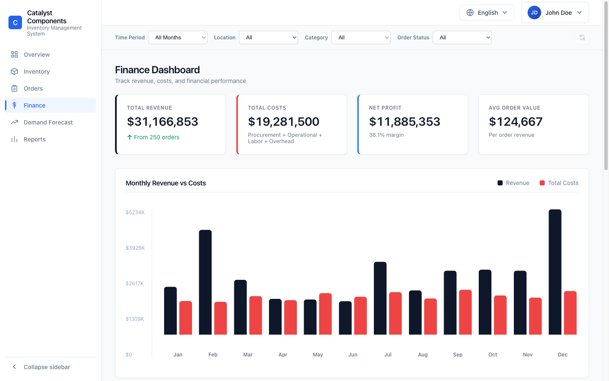

| Card | Meaning |
|---|---|
| Total Revenue | Sum of order values, with the number of orders |
| Total Costs | Procurement + Operational + Labor + Overhead |
| Net Profit | Revenue minus costs, with margin in % |
| Avg Order Value | Revenue per order |

Further down:
- *Monthly Revenue vs Costs*: dark bars for revenue, red bars for costs, one pair per month.
- *Monthly Cost Flow*: stacked costs per month. Click a month to see its cost breakdown.
- *Category Spending*: costs per spending category.
- *Recent Transactions*: ID, Description, Vendor, Date, Amount.

Only the Time Period filter affects this page.

## 7. Demand Forecast

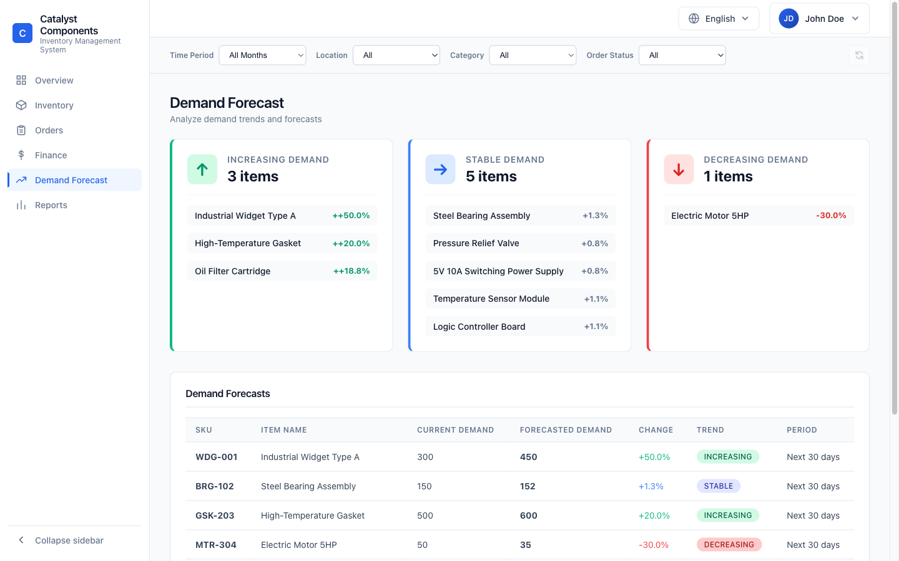

Three cards group items by trend: Increasing, Stable, Decreasing. Each card shows up to five items and "+N more".

The "Demand Forecasts" table lists SKU, Item Name, Current demand, Forecasted demand, Change %, Trend and Period. Location and Category narrow the list to items stocked there.

## 8. Reports

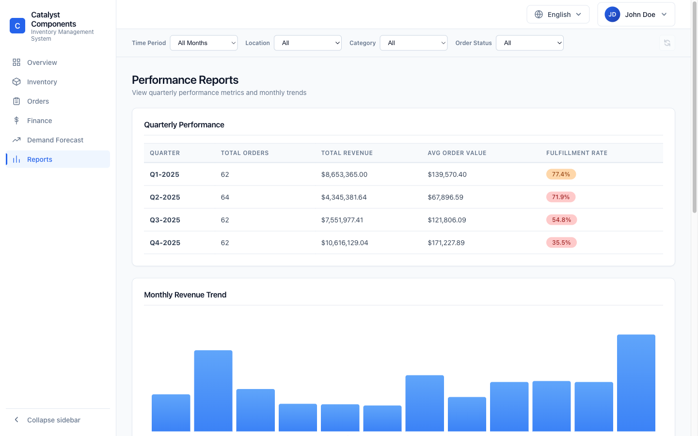

- *Quarterly Performance*: orders, revenue, average order value and fulfilment rate per quarter of 2025.
- *Monthly Revenue Trend*: one bar per month.
- *Month-over-Month*: orders, revenue, change and growth rate per month.
- Summary figures: Total Revenue YTD, Avg Monthly Revenue, Total Orders YTD, Best Quarter.

This page always shows the full year in US dollars. It ignores the filters and the language setting.

## 9. Profile and tasks

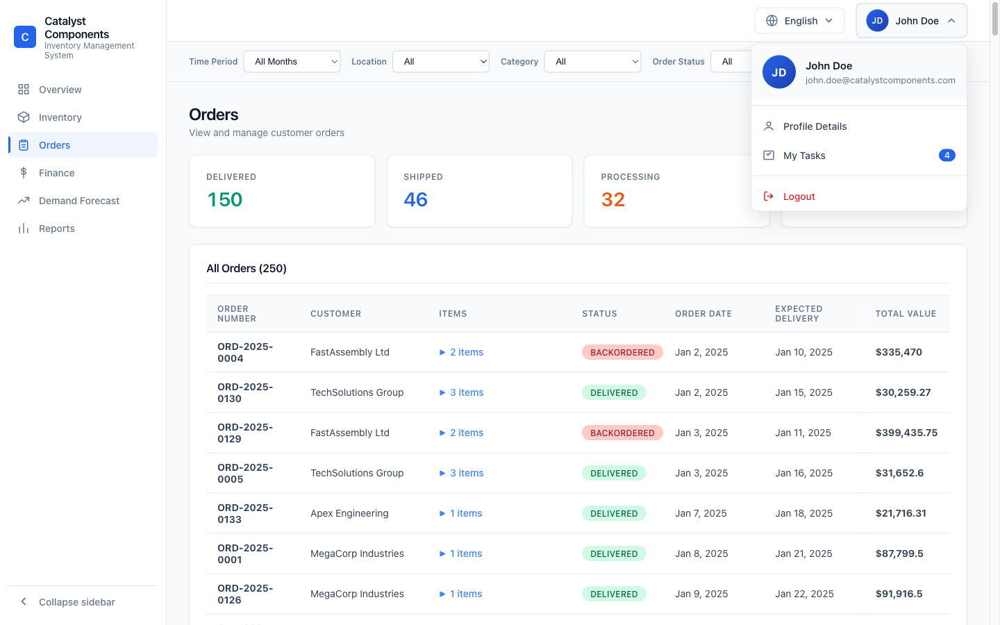

Click your name in the top right to open the profile menu:

| Entry | Action |
|---|---|
| Profile Details | Shows name, email, department, location, phone, start date, employee ID |
| My Tasks | Opens the task list. The blue number is the count of open tasks |
| Logout | Shows a message only; the demo has no login |

**My Tasks.**

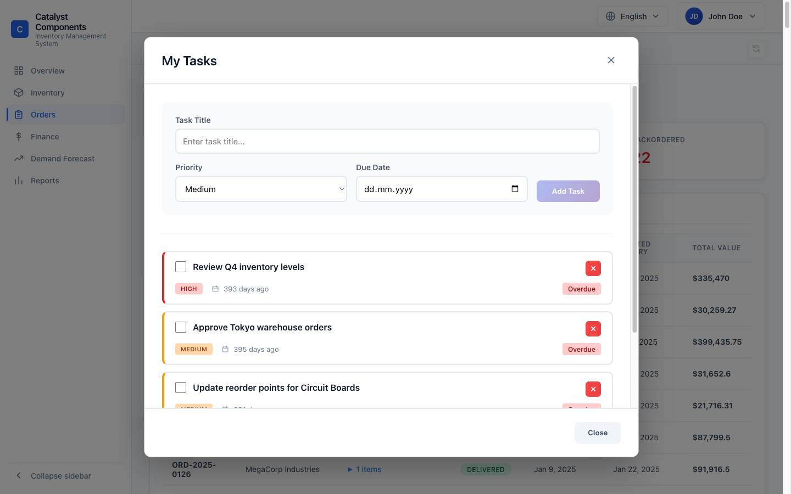

1. Enter a task title.
2. Choose a priority (High, Medium, Low) and a due date.
3. Click "Add Task".

Tick the box to mark a task done. Click the red x to delete it. Tasks past their due date are marked "Overdue". The coloured bar on the left shows the priority.

Tasks you add are saved on the server until it restarts. The built-in example tasks are not stored on the server.

## 10. Language and currency

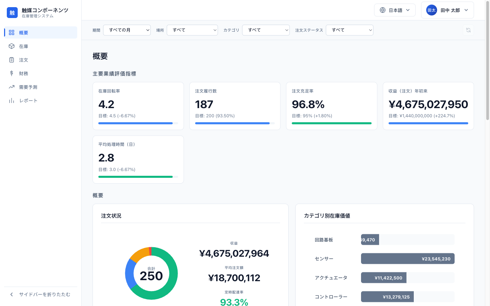

Use the language switcher (globe icon) to choose English or 日本語. The choice is saved in the browser and kept on the next visit.

Switching to Japanese changes all menus, labels and the user name, and shows money in yen (JPY) instead of US dollars. Reports and some dialogs stay in English.

## 11. Sidebar and small screens

**Collapse the sidebar.** Click "Collapse sidebar" at the bottom of the sidebar. Only the icons stay, and the content gets more room. Hover over an icon to see the page name. Click the arrow again to expand. The browser remembers your choice.

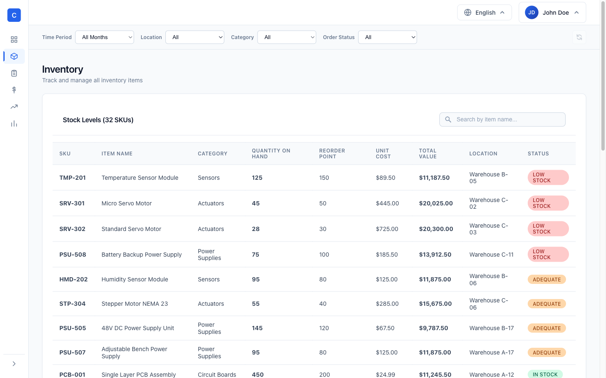

On screens 768 to 1024 pixels wide (for example a tablet), the sidebar starts collapsed until you choose otherwise.

**Phones (under 768 pixels).** The sidebar is hidden. Tap the menu button (three lines, top left) to slide it in. Tap a page, tap outside the menu or press Escape to close it. The filters stack vertically, and the profile and language buttons show only their icons.

| Phone layout | Navigation drawer |
|---|---|
| 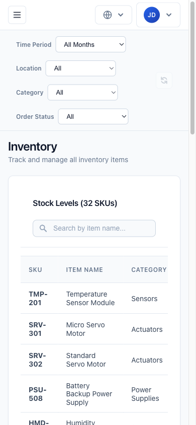 | 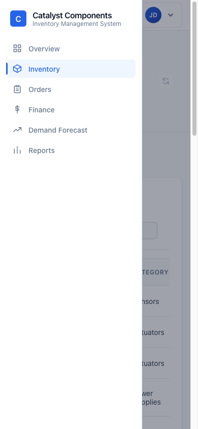 |

Wide tables scroll sideways inside their card.

## 12. Status colours

| Colour | Used for |
|---|---|
| Green | Delivered, In Stock, goal reached, positive change |
| Blue | Shipped, information, active page |
| Orange / yellow | Processing, Adequate, Medium priority, days delayed |
| Red | Backordered, Low Stock, High priority, shortage, overdue |
